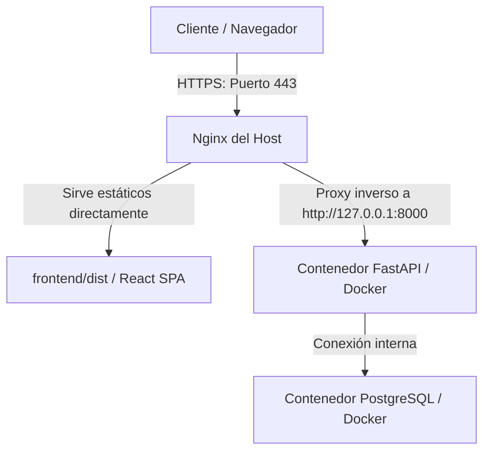

# Diseño: Configuración de Nginx y Subdominio acortador.kallpay.us

Este documento detalla el diseño técnico para configurar un subdominio personalizado (`acortador.kallpay.us`) apuntando a la aplicación de acortador de enlaces, usando Nginx en el host como proxy inverso y servidor de archivos estáticos para la SPA de React compilada para producción.

---

## 1. Arquitectura de Despliegue

La arquitectura utiliza un enfoque híbrido:
1.  **Nginx (Host)** sirve directamente la SPA (React) compilada a producción y maneja el cifrado SSL (HTTPS) con Let's Encrypt.
2.  **Docker Compose** corre el backend en FastAPI (puerto `8000`) y la base de datos PostgreSQL.
3.  **Nginx (Host)** redirige las peticiones dinámicas (`/api/*` y `/s/*`) hacia el contenedor de FastAPI.



---

## 2. Configuración de DNS y SSL

### DNS (Shopify / Registrar)
Para direccionar el tráfico a la máquina, se añade el siguiente registro en la configuración DNS de `kallpay.us`:
- **Tipo**: `A`
- **Nombre (Host)**: `acortador`
- **Dirección IP**: `31.220.97.55`
- **TTL**: Automático (1 hora)

### SSL / HTTPS
Se utiliza **Certbot** de Let's Encrypt para generar y auto-renovar certificados SSL. Certbot modificará la configuración de Nginx para obligar a usar HTTPS redirigiendo el puerto `80` al `443`.

---

## 3. Configuración de Nginx en el Host (Ubuntu)

El archivo de configuración `/etc/nginx/sites-available/acortador.kallpay.us` contendrá:

```nginx
server {
    listen 80;
    server_name acortador.kallpay.us;

    # Directorio de archivos estáticos de React
    root /home/acortador_url/frontend/dist;
    index index.html;

    # Habilitar compresión Gzip para mejor velocidad
    gzip on;
    gzip_types text/plain text/css application/json application/javascript text/xml application/xml;

    # Servir frontend (SPA Router Fallback)
    location / {
        try_files $uri $uri/ /index.html;
    }

    # Proxy inverso al Backend FastAPI (API)
    location /api {
        proxy_pass http://127.0.0.1:8000;
        proxy_set_header Host $host;
        proxy_set_header X-Real-IP $remote_addr;
        proxy_set_header X-Forwarded-For $proxy_add_x_forwarded_for;
        proxy_set_header X-Forwarded-Proto $scheme;
    }

    # Proxy inverso al Backend FastAPI (Redirecciones de URLs)
    location /s {
        proxy_pass http://127.0.0.1:8000;
        proxy_set_header Host $host;
        proxy_set_header X-Real-IP $remote_addr;
        proxy_set_header X-Forwarded-For $proxy_add_x_forwarded_for;
        proxy_set_header X-Forwarded-Proto $scheme;
    }
}
```

---

## 4. Compilación del Frontend (React)

La compilación se ejecuta dentro de un contenedor efímero utilizando la instalación de Node en Docker para evitar instalar Node.js en el host. El output se escribe en el host a través del volumen mapeado.

**Comando de compilación:**
```bash
docker compose run --rm frontend npm run build
```

---

## 5. Cambios en Docker Compose

Se modifica `docker-compose.yml` para:
- Deshabilitar el mapeo del puerto `5173:5173` del servicio `frontend` en producción, ya que Nginx sirve los estáticos.
- Mantener la definición del servicio `frontend` solo como una herramienta de utilería para compilación (`docker compose run --rm frontend npm run build`).

---

## 6. Plan de Ejecución e Hitos

1.  **Hito 1: Preparación DNS** - Crear el registro A en Shopify/Registrar DNS.
2.  **Hito 2: Compilación de Frontend** - Compilar los archivos estáticos de la SPA.
3.  **Hito 3: Modificación de docker-compose** - Ajustar configuraciones y levantar servicios de backend y BD.
4.  **Hito 4: Configuración de Nginx** - Instalar Nginx, configurar el bloque de servidor HTTP y comprobar sintaxis.
5.  **Hito 5: HTTPS con Certbot** - Instalar y ejecutar Certbot para cifrado SSL.
6.  **Hito 6: Pruebas y Validación** - Verificar conectividad HTTPS y redirecciones.
