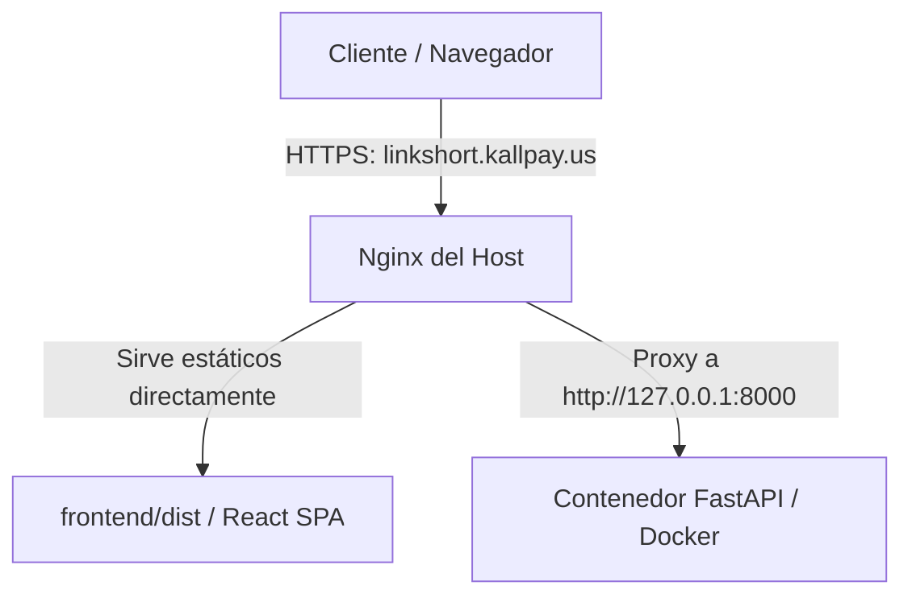

# Diseño: Actualización de Subdominio a linkshort.kallpay.us y Limpieza

Este documento detalla el diseño técnico para migrar el subdominio del acortador de enlaces de `acortador.kallpay.us` a `linkshort.kallpay.us`, configurando el nuevo subdominio en Nginx, obteniendo el certificado SSL correspondiente y eliminando de forma segura toda configuración y certificado anteriores.

---

## 1. Arquitectura y Cambios de Configuración

La arquitectura de proxy inverso se mantiene idéntica, cambiando únicamente el dominio destino de las peticiones HTTP/HTTPS:



### Configuración de Nginx en el Host (linkshort.kallpay.us)
El nuevo archivo de configuración `/etc/nginx/sites-available/linkshort.kallpay.us` contendrá:

```nginx
server {
    listen 80;
    server_name linkshort.kallpay.us;

    # Directorio de archivos estáticos de React
    root /home/acortador_url/frontend/dist;
    index index.html;

    gzip on;
    gzip_types text/plain text/css application/json application/javascript text/xml application/xml;

    location / {
        try_files $uri $uri/ /index.html;
    }

    location /health {
        proxy_pass http://127.0.0.1:8000;
        proxy_set_header Host $host;
        proxy_set_header X-Real-IP $remote_addr;
        proxy_set_header X-Forwarded-For $proxy_add_x_forwarded_for;
        proxy_set_header X-Forwarded-Proto $scheme;
    }

    location /api {
        proxy_pass http://127.0.0.1:8000;
        proxy_set_header Host $host;
        proxy_set_header X-Real-IP $remote_addr;
        proxy_set_header X-Forwarded-For $proxy_add_x_forwarded_for;
        proxy_set_header X-Forwarded-Proto $scheme;
    }

    location /s {
        proxy_pass http://127.0.0.1:8000;
        proxy_set_header Host $host;
        proxy_set_header X-Real-IP $remote_addr;
        proxy_set_header X-Forwarded-For $proxy_add_x_forwarded_for;
        proxy_set_header X-Forwarded-Proto $scheme;
    }
}
```

---

## 2. Plan de Limpieza (acortador.kallpay.us)

Para evitar acumulación de archivos innecesarios y errores en el proceso de renovación de Let's Encrypt:
1.  **Nginx**: Se eliminarán los archivos `/etc/nginx/sites-enabled/acortador.kallpay.us` y `/etc/nginx/sites-available/acortador.kallpay.us`.
2.  **Let's Encrypt**: Se revocarán y eliminarán los certificados SSL antiguos mediante Certbot:
    ```bash
    sudo certbot delete --cert-name acortador.kallpay.us
    ```

---

## 3. Plan de Ejecución e Hitos

1.  **Hito 1: Creación de Nueva Configuración**: Crear el archivo de Nginx para `linkshort.kallpay.us` y habilitarlo.
2.  **Hito 2: Certificado SSL para el Nuevo Subdominio**: Ejecutar Certbot para HTTPS.
3.  **Hito 3: Remoción de Configuración Antigua**: Eliminar los archivos de Nginx del subdominio anterior.
4.  **Hito 4: Limpieza de Certificados Viejos**: Eliminar los certificados de Let's Encrypt para `acortador.kallpay.us`.
5.  **Hito 5: Pruebas y Validación**: Probar el redireccionamiento HTTP -> HTTPS y los endpoints del backend en `linkshort.kallpay.us`.
